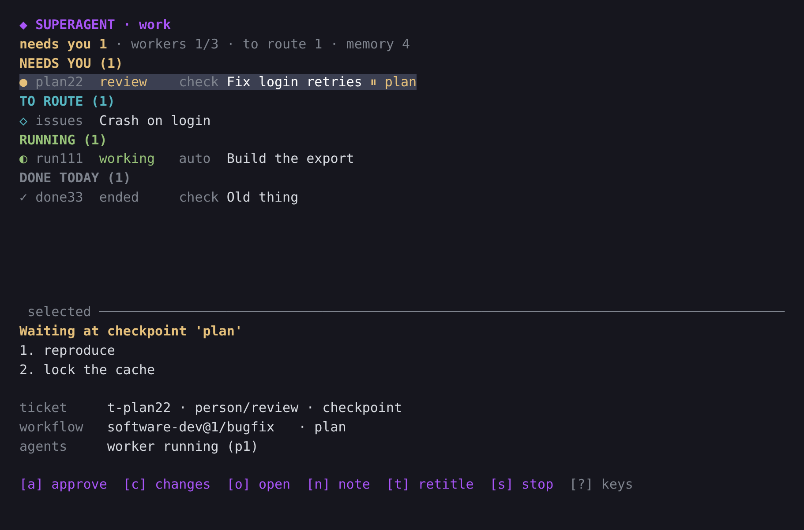

# herdr-superagent

A [herdr](https://github.com/herdrdev/herdr) plugin: one **superagent**
session that routes your requests into tickets, runs workers in herdr panes
and lets you review at checkpoints. Harness-agnostic (Claude Code, Codex and
Pi first), model-agnostic, one profile per context (work, personal, …).

The design is in [docs/PLAN.md](docs/PLAN.md). All six phases of the plan
are implemented: the engine, the daemon, profiles with calibration, the state
repo with its lease, workers in herdr panes and worktrees, delegation with
guard rails, workflow packs, sources, memory with a session importer and
search by meaning, and the interactive cockpit. `docs/phase-*.md` say what
each phase delivered and what has and has not been run against a live herdr.

## Install

```bash
herdr plugin install ribeirorod/herdr-superagent   # or: herdr plugin link /path/to/checkout
herdr-superagent start --profile work
```

The build step downloads the prebuilt binary for your platform (or builds it
with `cargo` when no release asset exists) and links it into `~/.local/bin`.
`herdr-superagent` must be on `PATH`: workers call it, and herdr uses it to
resume the daemon after a server restart.

## What it does

**One session routes, workers work, you review.** `herdr-superagent start
--profile work` opens the cockpit: the superagent session on the left, the
task list on the right, the daemon in a background tab. You type requests to
the session. It turns each into a ticket; a ticket runs in its own workspace,
in its own git worktree on its own branch, one tab per agent. The session has
no subagents of its own, so it cannot do the work instead of routing it, and
the daemon tells it only what needs a decision: a request to route, a
checkpoint, a question, a failure, a result.

**Modes decide how much you review.** `propose` plans only; `checkpoint`
(the default) stops at the plan and at milestones; `autonomous` runs end to
end behind guard shims that turn `git push` to a default branch, force
pushes, `gh pr merge` and `rm -r` outside the worktree into checkpoints. The
profile caps the mode per workflow and per repository.

```text
herdr-superagent approve <id> [--comment "…"]      # the worker continues
herdr-superagent request-changes <id> "…"          # it revises and asks again
herdr-superagent note <id> "…"                     # context, or a change of scope
herdr-superagent retitle <id> "…"                  # the workspace and record follow
herdr-superagent stop-ticket <id> | retry <id>
```



All of these are also keys in the cockpit (`a`, `c`, `n`, `t`, `s`, `r`,
`o` opens the ticket's pane), with the mouse working as in herdr.

**Workflow packs** say how a kind of work runs: who starts, which steps are
another role's (a reviewer in a sibling tab, on the review model tier) and
which checkpoints you must approve before the ticket may end.
`herdr-superagent packs` lists them; `general` (`general`, `research`,
`writing`) and `software-dev` (`feature`, `bugfix`, `code-review`) are built
in, and a directory `packs/<id>/` in the profile adds or replaces one. When
the session does not route, a keyword scorer picks the workflow.

**Workers start from the right code and look at all of it.** The ticket
branch is cut from the newest of the checked-out branch, its upstream and the
remote's default branch after a fetch (`submit --base <ref>` overrides it),
and the brief tells the worker to check every branch, open pull requests and
your uncommitted changes before it plans.

**Sources** bring work in besides you typing: `github` (the `gh` CLI),
`command` (any program printing JSON items: Jira, Bitbucket), or `session`
(the superagent looks through its MCP servers). Items are deduplicated by a
stable id and are never accepted without routing.

```bash
herdr-superagent profile set 'sources[+]={ id = "issues", kind = "github", repo = "owner/name", query = "assignee:@me", project = "~/src/name", workflow = "bugfix" }' --yes
herdr-superagent sources            # how each is fetched here, and its last poll
```

**Memory is per project.** Every worker ends with a summary; the next ticket
in that repository gets the matching ones in its brief. `memory import`
turns your earlier Claude Code, Codex and Pi sessions in the profile's
repositories into memory (extractive, redacted, incremental), and
`memory.semantic = true` finds entries by meaning as well as by words, with a
built-in embedder or a local Ollama model. Nothing leaves the machine.

If you already curate notes (one fact per markdown file, written by you or
your own summariser), point the profile at the folder and they become the
project's memory as they are: `profile set 'memory.notes[+]={ path =
"~/notes/out/myrepo", project = "~/src/myrepo" }'`. `MEMORY.md` and
`dropped/` are skipped, changed notes are re-read every five minutes, and
the importer then leaves that project alone. `memory.backend = "claude-mem"`
hands retrieval to claude-mem instead; ticket summaries are recorded either
way.

**Profiles move between machines.** With `state_repo.kind = "remote"` the
profile directory is a private git repo of ticket records, event logs and
summaries; one machine holds the lease, and `start` elsewhere pulls, takes
it over and continues open tickets from their pushed branches.

A profile's first start is the **calibration** interview: the superagent
runs `doctor`, asks how you work and writes the profile through `profile
set`, which validates, diffs and keeps history for `profile undo`. Keys that
change how much review a request gets (`modes`, `repos`, `limits`,
`routing`, `sources`) only you can change, with `--yes`.

The CLI works from any shell: outside a herdr pane it finds herdr's socket
itself.

## Testing a checkout in your herdr

```bash
git clone https://github.com/ribeirorod/herdr-superagent ~/src/herdr-superagent
cd ~/src/herdr-superagent
cargo build --release
mkdir -p bin ~/.local/bin
rm -f bin/herdr-superagent && cp target/release/herdr-superagent bin/   # replace, never overwrite (macOS kills an overwritten binary)
ln -sf "$PWD/bin/herdr-superagent" ~/.local/bin/herdr-superagent   # must be on PATH
herdr plugin link ~/src/herdr-superagent                            # from a herdr pane
herdr-superagent --debug start --profile test
```

After pulling: `cargo build --release && rm -f bin/herdr-superagent && cp
target/release/herdr-superagent bin/ && herdr-superagent ensure`. The daemon
notices the new version and restarts itself in its pane. On macOS never `cp`
over the existing binary: the kernel caches its code signature and kills every
launch with `killed`; replace the file or run
`codesign --force --sign - bin/herdr-superagent`.

## Debugging

`--debug` (or `HERDR_SUPERAGENT_DEBUG=1`) makes every process log at debug
level: each herdr request and response, each daemon call, each effect, the
state reports to herdr and the daemon's own decisions. Logs go to one file per
process kind under `~/.local/share/herdr-superagent/profiles/<profile>/logs/`
(`daemon.log`, `cli.log`, `ensure.log`), rotated at 20 MB.

```bash
herdr-superagent --profile test logs --follow             # tail everything
herdr-superagent --profile test logs --process daemon --lines 500
herdr-superagent --profile test debug-bundle              # one tar.gz to share
```

The bundle holds the logs, `daemon.json`, `profile.toml`, `calibration.md`,
`doctor`, `status`, all tickets, the herdr session snapshot and the plugin
list, plus the `HERDR_*`/`SUPERAGENT_*` environment. It never includes
credentials or MCP configs.

## Development

`cargo test` includes `tests/e2e.rs`: the real daemon and CLI against a fake
herdr socket, covering a ticket from request to review with a spawned
reviewer, guard shims, sources and imported memory.

```bash
cargo test
cargo clippy --all-targets -- -D warnings
cargo fmt --all -- --check
herdr plugin link .          # inside herdr, with bin/herdr-superagent built
```

State lives under `~/.local/share/herdr-superagent/profiles/<profile>/`,
config under `~/.config/herdr-superagent/profiles/<profile>/profile.toml`.
`HERDR_SUPERAGENT_STATE_DIR` and `HERDR_SUPERAGENT_CONFIG_DIR` override both
for throwaway runs; `HERDR_SUPERAGENT_LOG` sets the log filter.

## License

MIT. The engine re-implements, in Rust, the kept part of DeepSeek's
[dsh-superagent prototype](https://github.com/deepseek-ai/dsh-superagent-prototype)
(MIT), using its tests as the specification; see [docs/rejected.md](docs/rejected.md)
for what was left out and why.
