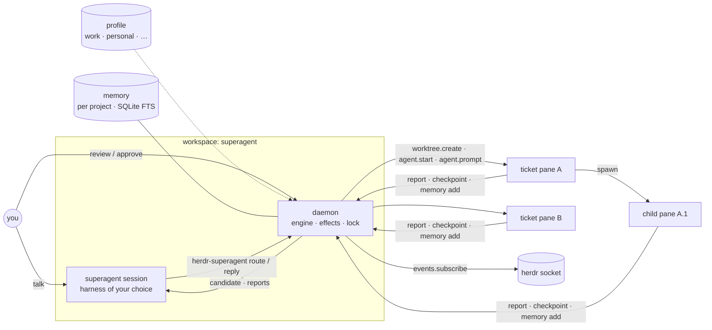

# herdr-superagent — plan

A herdr plugin, written in Rust, that is the **foundation agent of a
daily-work kit**. You start it when you want it. It opens a superagent session
in the harness you choose. It works under a **profile** (work, personal,
side-projects) that it calibrates with you. It dispatches work to other herdr
panes and workspaces, follows them, stops for your review where the profile's
mode says so, and keeps a memory of every task.

* **Base:** pure upstream herdr (`herdrdev/herdr` master, v0.9.5). No herdr
  fork.
* **Repo:** its own, `ribeirorod/herdr-superagent`. This branch is only the
  planning base.
* **Lineage:** the engine ideas come from DeepSeek's `dsh-superagent-prototype`.
  The prototype's code is TypeScript and its core is built around chat threads,
  so it is a reference, not a code base to lift.
* **Status:** plan v2. It includes an independent review of v1 (sections
  marked *review*) and the workflow vision from 2026-11-08.

---

## 1. Why: the problems it solves

| # | Problem today | What the plugin gives |
|---|---|---|
| **P1** | Many parallel agent sessions in herdr. Hard to see what each is doing, which need me and which are done | One place that maps every task to its pane, a single "needs you" list, and status in herdr's sidebar |
| **P2** | Agents run helpers inline (hidden subagents) instead of in visible panes. No agent watches another | Agents that know they run inside herdr, a rule for when to delegate to a separate pane, and visible parent→child supervision |
| **P3** | Different kinds of work (software, marketing, research) need different roles and steps | An abstract engine with pluggable workflow packs. Packs complement each other; the superagent is the base |
| **P4** | I want to stay in control | Modes: no-risk tasks run end to end, risky ones stop at checkpoints for review |
| **P5** | Work and personal setups differ (Bitbucket/Jira/Slack/Gmail vs. GitHub), and preferences change | **Profiles**, calibrated with me and adjusted by the superagent from my answers |
| **P6** | Each harness forgets; context is lost between sessions and tasks | A shared **memory layer**: every task ends with a summary attached to its ticket, searchable later |

## 2. The daily workflow

```text
$ herdr                                   # herdr server + client as usual
$ herdr-superagent start --profile work   # or: --harness codex  --model …
```

1. **Start is opt-in.** Nothing runs until you start it. `start` takes
   `--profile` (default: the last one used), and optionally `--harness` and
   `--model` to override the profile for this session. It is also a herdr
   action, *Superagent: start*.
   * herdr gives plugins no `herdr <name>` subcommand: unknown commands are
     rejected (`src/cli.rs`). So the entry point is the plugin's own binary,
     `herdr-superagent`, which the plugin installs. The herdr action and
     `herdr plugin action invoke ribeirorod.superagent.start` reach the same
     code. A plugin CLI alias in herdr is a possible upstream ask.
2. **It opens the superagent session.** `start` makes sure the `superagent`
   workspace exists, with a daemon pane for the engine, and starts the
   superagent itself in the chosen harness (`agent.start --kind claude|codex|pi|…`).
   **You talk to this session.** It is DeepSeek's "main session": it routes,
   dispatches and reports, and does no technical work itself.
3. **It calibrates.** On the first start of a profile, or when the profile is
   stale, the superagent interviews you (section 4) and writes the profile.
4. **You hand it work** by typing in its pane, via `herdr-superagent submit "…"`,
   or from a herdr action. It routes each request: which workflow, which role,
   which harness and model, which mode. Then it spins workers into panes and
   workspaces.
5. **You review where the mode says so.** Workers stop at checkpoints. The
   "needs you" list shows them; you approve, ask for changes or stop.
6. **Every task leaves a memory.** Each worker ends with a summary attached to
   its ticket (section 7). The superagent searches memory before routing.
7. **Stop it any time.** `herdr-superagent stop` ends the superagent session.
   Workers keep their panes, and tickets keep their state for the next start.

## 3. Profiles

A profile is a directory, one per context:

```text
~/.config/herdr-superagent/profiles/
  work/
    profile.toml       # tools, repos, harness/model preferences, modes, memory
    calibration.md     # what was learned in calibration, in prose, versioned
    packs/             # workflow packs enabled for this profile
  personal/
  side-projects/
```

```toml
# profiles/work/profile.toml
id = "work"
description = "Day job: Bitbucket, Jira, Slack, Gmail"

[superagent]
harness = "claude"                 # the session you talk to
model = "opus"

[tools]                            # what the workers may use, and how
code_host = "bitbucket"            # vs "github" in profile personal
issues = "jira"
chat = "slack"
mail = "gmail"
access = "mcp"                     # through the harness's own MCP/connectors

[[repos]]
path = "~/work/payments-api"
default_branch = "main"
notes = "PRs need 2 approvals; never push to main"

# Which harness and model per kind of task, with fallbacks in order.
[models.hard]                      # design, refactors, debugging
use = [{ harness = "claude", model = "opus" }, { harness = "codex", model = "gpt-5" }]
[models.small]                     # quick edits, lookups, summaries
use = [{ harness = "pi", model = "haiku" }, { harness = "codex", model = "mini" }]
[models.review]
use = [{ harness = "codex", model = "gpt-5" }]

[limits]
max_workers = 4

[modes]                            # see section 6
default = "checkpoint"

[memory]
scope = "project"                  # sessions share memory within a repo, never across
semantic = false                   # v1: local full-text search only (section 7)
```

* **Model names are only strings handed to the harness.** The plugin never
  calls a model itself, except to embed memory (section 7). That keeps it
  harness and model agnostic.
* **Fallbacks:** when a harness is not installed, fails to start, reports a
  rate or credit limit, **or lacks an MCP server the task needs** (for example
  Jira), the next `use` entry is tried. The ticket records which one ran.
* **Profiles are isolated:** separate database, packs, repos and tools. A work
  ticket never sees personal memory, and memory inside a profile is scoped per
  project (section 7).
* **With a state repo** (section 8a), the profile directory *is* a checkout of
  that repo, so the profile travels with the tickets.

## 4. Calibration

Calibration is a conversation, not a form. The superagent runs it in its own
session with a built-in calibration skill:

1. **Inventory.** It asks which tools you use for code, issues, chat and mail,
   which repos you maintain, and how you work. It verifies what it can: whether
   the repos exist, which harnesses are installed, and which MCP servers each
   harness has. That check is per harness (`claude mcp list`, Codex's
   `config.toml`, Pi's extension config), so the profile records MCPs per
   harness, not once.
2. **Preferences.** Which harness and model for hard work, small work and
   review, and the fallbacks. Daily rhythm (for example: morning triage, then
   execution).
3. **Control.** Which kinds of work may run end to end and which need review
   (section 6). It proposes defaults and you adjust them.
4. **Write.** It writes `profile.toml` and `calibration.md` through
   `herdr-superagent profile set …`, which validates the change. It shows you
   a diff before saving.

**Self-adjustment.** During normal work the superagent may change the profile
from your answers ("use Codex for reviews from now on"). Every change:
* goes through `profile set`, so it is validated and versioned;
* is shown to you as a one-line diff in the superagent session;
* can be undone with `herdr-superagent profile undo`.

**Hard limit:** the superagent can never change anything that makes a request
run with less review. The protected set is everything that affects which mode
a request resolves to: `modes`, `[[repos]]` paths, `limits`, `routing`, and the
model tiers of autonomous rules. Only you can change those, with
`herdr-superagent profile set … --yes` from your own shell. For every profile
change, `profile set` also replays the last 50 requests against the new rules
and shows any request whose mode would change.

## 5. Architecture



### 5.1 Process model

* The daemon runs in a pane of the `superagent` workspace, so its lifetime is
  the herdr server's.
* It registers itself with `pane.report_agent --source superagent` and a
  `resume_argv`, so herdr brings it back after a server restart *(review;
  confirm with a smoke test)*.
* **One daemon per profile:** a lock file in the profile's state directory.
* `ensure` (run by `[[startup]]`, `start`, and every action) is idempotent:
  * it creates the workspace if it is missing;
  * it checks the daemon's version and restarts it after `herdr plugin update`,
    because herdr does not restart running processes (`plugins.mdx`).

### 5.2 Language: Rust

One static binary, `herdr-superagent`, with subcommands for the CLI, the
daemon and the hooks. That matches herdr's own stack and avoids a Node
dependency.

* **herdr API:** newline-delimited JSON over `$HERDR_SOCKET_PATH`. Request and
  response types are written in the plugin, checked against
  `herdr api schema --json` in CI. Do not depend on the herdr crate: it is a
  binary, not a library.
* **Store:** `rusqlite`, with FTS5 for memory search, behind a `Repositories`
  trait so another backend can be added later.
* **Build:** the manifest's `[[build]]` downloads the prebuilt release binary
  for the platform (decided; Rust compile times).

### 5.3 Engine (the reusable 30–40 %)

*Review:* most of the prototype's `src/core` is built around Threads,
Subscriptions and Channels. Re-implement only:

* **Kept:** the model (Ticket, Mandate, Assignment, Report), stages,
  assignment rules, ids, error and reason codes, the effects queue and the
  store design. Each comes with the prototype's tests as a specification.
* **New:** a single **Request** concept replaces Trigger + Thread. A `Source`
  port is a stub (your typing and `submit`) until phase 4.
* **Rejected for now** (keep a table of these, like the prototype's
  docs/001): Threads, Subscriptions, Correlation, Channels, the admission
  table, bot lists, PR-follow ending (`followsDone`), Feishu, the web panel.

Domain model:
* A **Request** (from you, or later from a source) becomes a **Ticket** with a
  **Mandate**: who asked, which rule allowed it, which mode, and the profile,
  policy and pack versions.
* A Ticket runs as **Assignments**, one per run of one role in one pane.
* An Assignment ends with **Reports** (`progress · waiting · ready · blocked ·
  failed · dropped`).
* The **stage** (`person/answer · person/review · person/blocked ·
  working/queued · working · idle · ended`) says who has the ball.

### 5.4 Agent ↔ engine contract: a CLI

Every coding agent can run shell commands, so the API is
`herdr-superagent <verb>` on the pane's PATH.

* **Identity:** the engine's pane→ticket map is the source of truth.
  `SUPERAGENT_TICKET` and `SUPERAGENT_ROLE` are a convenience, set through
  `tab.create --env` or `pane.split --env`.
* *Review:* `worktree.create` and `agent.start` take no `env`
  (`src/api/schema/worktrees.rs`, `agents.rs`). Only `workspace.create`,
  `tab.create`, `pane.split` and `layout.apply` do.

```text
# workers
report      --state … --summary … [--question …]   # authoritative status
checkpoint  <name> --summary …                     # ends the turn, waits for review
spawn       --role reviewer --task … [--tier small] [--harness …]
watch       <ticket|pane>
inbox | ack <id>
memory add  --summary-file …  |  memory search "…"
# superagent session
route       <request> accept|attach <ticket>|stop|ignore --workflow … --mode …
reply | note | status <ticket> | retry <ticket>
profile get|set|undo
# you
start | stop | submit "…" | approve <ticket> | stop-ticket <ticket> | digest
```

**Question semantics** come from the prototype's `assignments.report`:
* `--question` is structured;
* repeating the same text keeps the question;
* different text replaces it;
* `--question ""` clears it;
* a question together with `ready` is refused.

## 6. Modes and control (P4)

Three modes, set per ticket by the profile's rules. The superagent proposes
one when it routes; a rule can cap it.

| Mode | Meaning | How it is enforced |
|---|---|---|
| `propose` | Plans only; nothing runs until you approve the plan | The worker brief ends at the plan step |
| `checkpoint` | Runs, but stops at declared milestones and before risky actions | Declared checkpoints, plus the harness's own permission prompts left **on**: herdr shows them as `blocked`, so they land in "needs you" |
| `autonomous` | End to end, reports when done | Harness permissions off, guard shims on PATH for risky commands, budget limits |

```toml
# in profile.toml
[modes]
default = "checkpoint"
rules = [
  { match = { workflow = "research" },                       mode = "autonomous" },
  { match = { repo = "~/scratch/*" },                        mode = "autonomous" },
  { match = { risk = ["remote-write", "spend", "send", "delete"] }, mode = "checkpoint" },
]
```

**Checkpoints end the turn; they do not block a tool call** *(review)*.
1. The worker calls `checkpoint`, which records `person/review` and tells it to
   stop.
2. On approve, the engine resumes the worker with `agent.prompt`.

A blocking call would hit harness tool timeouts.

**Risk tags** come from three places:
* the workflow step;
* the superagent's classification of the request. This adapts the prototype's
  assessment triple: is the intent established, is the target settled, is a
  design decision still open?
* guard shims in autonomous mode (`git push`, `gh`/`bb` PR merge, mail or chat
  send, `rm -rf` outside the worktree). A shim turns the action into a
  checkpoint. It is a guard rail, not a sandbox.

**Budgets:** wall-clock time per ticket, and turns measured as `completion_seq`
deltas (herdr has no turn count).

**Policy changes** follow the prototype: a running ticket gets a note, never a
revocation. The mandate is re-checked only before a resume. A child can never
run in a more autonomous mode than its parent.

**Never auto-answer a `blocked` dialog** below `autonomous`. `agent.prompt`
refuses blocked agents anyway (`agent-automation.mdx`).

## 7. Memory (P6): per project, cheapest first

**Scope: a project inside a profile.** Sessions of the same project share
memory across Claude Code, Codex and Pi; nothing is recalled across projects,
and nothing ever crosses profiles.
* A **project** is the ticket's repo: the `origin` `org/repo` slug when there is
  one, else the repo root's name. **Worktrees map to their repo**, so every
  worker of `payments-api` shares `payments-api` memory.
* Work outside a repo goes to an explicit `<profile>/notes` bucket, searched
  only on request.
* The engine resolves the project **before** searching, so the router's "have
  we done this before?" looks only in the request's repo.

**Three layers.**
1. **Ticket record** (always on, source of truth): `ticket.md`, `events.jsonl`
   and `summaries/*.md` in the state repo (section 8a).
2. **Local search** (always on, v1): a SQLite FTS5 index over summaries and
   notes, rebuilt from layer 1 by `reindex`. `herdr-superagent memory search`
   is the only search surface the superagent and workers use, and it **always
   carries the project** — scope is enforced by the engine, not by agents.
3. **Semantic / automatic memory** (optional, later, behind a `MemoryStore`
   trait): sqlite-vec with a local embedder, or claude-mem (below). Any external
   store is a cache fed from layer 1 by replaying summaries idempotently.

**Session summaries.**
* Every worker's brief ends with: "before your final report, write a session
  summary and run `herdr-superagent memory add`".
* Fixed sections: goal, what was done, decisions, open ends, files and links.
  Unique title `<ticket>/<assignment> <role>: <goal>`.
* Secrets are redacted **before** the summary is written anywhere.
* How each harness writes a good summary is a per-harness skill.
* A worker that ends without one gets the turn-end fallback text, marked
  `unsummarized`.

**Use.** The superagent searches the request's project before routing and puts
the top hits in the worker brief. Workers search the same project themselves.
`digest` summarizes a day or a profile.

### claude-mem evaluation (2026-11-08)

`thedotmack/claude-mem` v15.12 (Apache-2.0) was evaluated as the memory layer.
It is token-efficient for the *reader* (a compact index, then details on
demand) but not for the *writer*: its observer is a second model call per tool
event. Findings, verified in its code:
* **Observer off** (`CLAUDE_MEM_OBSERVER_ENABLED=false`) stops all model calls;
  search keeps working.
* Writes go through `POST /api/memory/save` (`MemoryRoutes.ts`).
  `/api/memory/ingest` only imports Claude Code's auto-memory files.
* **Manual saves never appear in session-start context**
  (`ObservationCompiler.ts`), and the "recent sessions" block needs
  observer-written summaries. With observer off, a new session gets nothing
  automatically; agents must search.
* **Search defaults to all projects** unless a project is passed
  (`SearchManager.ts`), and no setting pins it. Scope would have to be enforced
  by us anyway.
* **Worktrees get their own project key** (`<repo>/<branch-slug>`,
  `project-name.ts`) unless `CLAUDE_MEM_PROJECT_NAME_SOURCE=git-remote` is set.
* Per-profile workers need their own `CLAUDE_MEM_DATA_DIR` **and**
  `CLAUDE_MEM_WORKER_PORT` (the default port is per Unix user).
* It brings Bun, Node ≥ 20.19, and uv + Python + chroma-mcp for vector search,
  plus telemetry on by default (`CLAUDE_MEM_TELEMETRY=0`).
* Pi needs its worker runtime; the Postgres "server" runtime rejects Pi.

**Decision:** observer-off claude-mem is a note store over HTTP that our own
FTS5 index matches for v1, with exact project scope and no extra runtime. So v1
uses layers 1–2 only. Revisit claude-mem **observer on, with a cheap model** in
phase 3+ for the one thing we cannot cheaply build: automatic capture of
sessions run outside the superagent. Then it is an external, read-mostly
source queried with an explicit project. Postgres is not part of v1.

## 8. Dispatch and supervision (P1, P2)

**Routing** follows the prototype:
* **Explicit** requests are routed cheaply. A request that names its workflow
  (`submit --workflow`) skips routing entirely.
* **Ambiguous** requests are assessed.
* The candidate has a deadline that starts when it is delivered to the
  superagent session. Two requeues, then `unavailable`, then the deterministic
  keyword scorer takes over.
* `routing = always | ambiguous | never` is a profile setting.

**Workers.**
* `worktree.create` for repo work, `workspace.create` otherwise. Then
  `tab`/`pane` with env.
* Then `agent.start` with the tier's harness, and a short `agent.prompt` that
  points at `.superagent/brief.md`.
* `max_workers` per profile; extra tickets wait as `working/queued`.
* A worker that reported `ready`, a question, `blocked` or `failed` frees its
  slot.

**Turn-end fallback** — the most important rule, because herdr knows panes but
not turns:
* `completion_seq` advanced and no `report` since the last turn → record
  `waiting` with `agent.read` output;
* then ask the worker for a status-only report;
* `unknown` for too long → `failed: agent not detected`.

**Observation** *(review)*:
* one `events.subscribe` connection: session-wide lifecycle events, plus
  `pane.agent_status_changed` per ticket pane;
* a full `session.snapshot` only at startup or on `events_lost`;
* no per-event hook processes, because of the 32-command cap.

**You typing in a worker pane** counts as a follow-up: the stage goes back to
`working`, and the superagent may then only stop that ticket, not reroute it.
A worker asked for out-of-scope work runs `handback`.

**Delegation** (P2) is a **superagent skill**, installed the way herdr's own
skill is (`npx skills add ribeirorod/herdr-superagent --skill superagent`). It
applies only when `SUPERAGENT_TICKET` is set, and states that it takes
precedence over herdr's skill. herdr's skill says to use herdr only when the
user asks, and to prefer a sibling pane (`skills/herdr/SKILL.md`).

Spawn into a pane instead of inline when:
* the work is long-running;
* it needs another harness or model tier;
* it should run in parallel;
* it is in another repo;
* you should be able to watch it;
* or the workflow says the step is a separate role.

A spawned child is a new assignment under the same ticket, in the same mode or
a stricter one. The parent supervises it with `watch` (`agent.wait` plus
reports).

**Visibility, without building a UI first:**
* `agent.view.set` with a plugin-owned view that filters on a pane token
  `sa_stage` and sorts by attention. This is the "needs you" list in herdr's
  sidebar.
* `pane.report_metadata` and `workspace.report_metadata` show stage and ticket.
* Toasts are batched, because `notification.show` is limited to one per
  second.
* A console pane comes later.

**Recovery** (moved into v1):
* Panes that still exist are re-attached. herdr restores agent conversations
  after a restart, so "continue" is often enough.
* Otherwise the assignment restarts with the prototype's recovery note, but
  only if it was mid-work or received inputs after its last report.
* `submit` is idempotent.

## 8a. State repository: tasks that follow you between machines

DeepSeek's prototype keeps everything in one SQLite file on one machine, run in
tmux, and only advises backing that folder up (`docs/006-deployment.md`). It has
no sync; the only shared state is GitHub itself. Here, each profile can have a
**state repo**: a private git repo the superagent keeps up to date, so you can
stop on one machine and start the same profile on another.

**Calibration asks:** no state repo, a local git repo only, or a remote
(`git@github.com:you/superagent-personal.git`). The work profile uses a
private repo on the **company's** Bitbucket, never personal GitHub, because
tickets and summaries hold company data.

**What goes in it: plain text, never the database.**

```text
superagent-work/                    # the profile's state repo
  profile.toml  calibration.md      # the profile itself (section 3)
  tickets/
    2026-11-08-fix-login-a1b2c3/
      ticket.md                     # frontmatter: id, stage, mode, mandate, repo, branch, pane-less
      events.jsonl                  # append-only: reports, checkpoints, approvals, routing
      summaries/01-builder.md       # session summaries (section 7)
  memory/<project>/notes/*.md       # notes added with `memory add`, per project
  .superagent/lease.toml            # which machine runs this profile now
```

* **Text in git, database local.** SQLite and its search index are a local
  cache that the daemon rebuilds from the repo (`herdr-superagent reindex`).
  Embeddings, if enabled later, are not committed. That avoids binary merges and makes
  the repo readable and reviewable on its own.
* **Append-only events** per ticket keep merges trivial: one ticket's files are
  only written by the machine holding the lease.
* **Commits** are batched by the daemon: on stage changes, checkpoints and
  summaries, at most once a minute, then pushed. Commit messages are generated
  (`ticket a1b2c3: review -> working`).
* **Never in the repo:** secrets, tokens, MCP configs with credentials, raw
  transcripts. Summaries pass a secret-redaction step before commit.

**One machine at a time per profile (lease).**
* `start` pulls, writes the lease (`machine`, `since`, `expires`) and pushes it
  as a **fast-forward of the commit it just pulled**. A rejected push means
  another machine got there first: `start` re-pulls and refuses, showing where
  the profile runs. `start --take-over` breaks a stale lease the same way.
* The lease lasts three renew intervals (renewed every 5 minutes, expires
  after 15), which absorbs clock skew and short network outages.
* `stop` finishes the batch, pushes, and releases the lease.
* The daemon renews the lease while running, so a crashed machine's lease
  expires on its own.

**What moves and what doesn't.** Ticket records, summaries, profile and memory
move. Panes, agent sessions and worktrees are local and do not. On the new
machine:
* ended tickets are just history and memory;
* open tickets come back as `idle` with a **recovery assignment**: a fresh
  worktree from the ticket's pushed branch, and the brief plus the summaries
  so far. That makes "push work-in-progress branches at each checkpoint" a
  worker rule when a state repo is configured.

This also covers a server setup later: a headless herdr on a server is just
another machine holding the lease.

## 8b. The superagent cockpit (UI)

As more work moves to workers, you lose direct contact with the agents. The
cockpit keeps you in touch: you **talk** to the superagent on the left and
**see** everything that is happening on the right.

```text
┌─ ◆ SUPERAGENT · work ──────────────────────────┬─ Tasks ─────────────────────┐
│                                                │ NEEDS YOU (2)               │
│  superagent session                            │  ● a1b2 plan review   claude│
│  (Claude Code / Codex / Pi, your choice)       │  ● c3d4 blocked: trust codex│
│                                                │ RUNNING (3/4)               │
│  you: what's the status of the login fix?      │  ◐ e5f6 build login  claude │
│  superagent: a1b2 is waiting for your review   │  ◐ g7h8 research …   pi     │
│  of the plan; c3d4 needs a trust prompt …      │ QUEUED (1) · DONE today (5) │
│                                                │ ─────────────────────────── │
│                                                │ [approve] [open] [stop]     │
└────────────────────────────────────────────────┴─────────────────────────────┘
```

**Layout.** `start` builds the `superagent` workspace with `layout.apply`: the
superagent session on the left (about 65 %), the **dashboard pane** on the right,
and the engine's daemon in a background tab. `--layout full` keeps the session
full-screen with the dashboard as a popup action.

**Dashboard pane.** A ratatui app inside the plugin binary
(`herdr-superagent dashboard`), so it looks and feels like herdr itself.
* Live from the engine over its local socket: *Needs you · Running · Queued ·
  Done today*, with per-task role, harness, stage, milestone and age.
* Mouse-first, like herdr: click a task to see its latest report and summary;
  **open** focuses its pane, **approve / request changes / stop** act on it.
* Header: profile, mode counts, workers in use (`3/4`), router health.

**Telling the superagent apart.** What herdr allows today:
* Terminals cannot change fonts. Styling is limited to colour, bold, dim and
  symbols, and herdr cannot give one pane or one sidebar row its own
  background.
* **Sidebar:** the plugin reports a custom token `$sa_role = superagent` on the
  superagent's pane (`pane.report_metadata`). A sidebar rule
  (`ui.sidebar.agents` token styles with `rules`) shows it bold and in the
  superagent's purple (`#a855f7`), for example `◆ SUPERAGENT · work`, and worker rows show `$sa_task`
  (`a1b2 · review`). The plugin offers this config snippet during calibration;
  you add it to your herdr config.
* **Names:** the workspace label `◆ superagent · work` and the pane title.
* Upstream asks for more: a per-workspace accent colour, and sidebar row
  overrides keyed by a token rather than only by agent kind
  (`rows_by_agent` takes agent ids only).

**Phasing.** v1 ships the left/right layout with a simple read-only task list.
The interactive dashboard is its own phase (6).

## 9. Workflow packs (P3)

The engine knows nothing about software or marketing. A pack declares roles,
workflows and checkpoints:

```text
packs/software-dev/
  pack.toml          # id, version, default mode
  roles/*.md         # frontmatter: name, tier, tags; body = role prompt
  workflows/*.toml   # ordered steps: role, goal, checkpoint?, risk tags, layout
  skills/
```

```toml
# workflows/feature.toml
id = "feature"
match = { tags = ["feature", "bug"] }
steps = [
  { role = "planner",  goal = "plan + acceptance criteria", checkpoint = "plan" },
  { role = "builder",  goal = "implement in worktree" },
  { role = "reviewer", goal = "review the diff", tier = "review" },
  { role = "builder",  goal = "open PR", risk = ["remote-write"] },
]
```

**Roles and panes.** A role is bound to a pane in the ticket's workspace. The
same role reuses its pane across steps, and the worktree persists between
steps. Packs can declare the ticket's pane layout through `layout.apply`.

**Trust ladder** (from the prototype's docs/004):
1. host-enforced facts;
2. built-in prompts;
3. profile rules;
4. pack text;
5. outside text (issues, mail, web), which is treated as data only.

Pack version is recorded in the mandate.

Ship with `general` (one worker) and `software-dev`. Marketing and research
packs come after these two work.

## 10. Install

```bash
herdr plugin install ribeirorod/herdr-superagent
npx skills add ribeirorod/herdr-superagent --skill superagent -g
herdr-superagent start --profile work      # first start runs calibration
```

Manifest sketch:
* `[[build]]` fetches or builds the binary.
* `[[startup]]` runs `herdr-superagent ensure`.
* Actions: *start*, *submit*, *adopt pane*, *approve*, *stop ticket*, *pause*.
* `[[panes]] console` as a popup, later.
* `[[link_handlers]]` for issue URLs, later.

## 11. Phases

**v1 = "a superagent with modes that can spin workers and let me review."**

| Phase | Scope | Done when |
|---|---|---|
| **0 Skeleton** | Rust repo; manifest; `ensure` with version check and lock; daemon pane; **smoke test that `pane.report_agent` + `resume_argv` brings the daemon back after a server restart**; SQLite store; engine core (Request, Ticket, Mandate, Assignment, Report, stages, effects) with the prototype's tests as spec | `herdr plugin link .` + `herdr-superagent start` opens the workspace; core tests pass; restart smoke test recorded |
| **1 Start + profile** | `start --profile --harness --model`; profile files; minimal calibration (tools and per-harness MCPs, repos, model tiers, modes, state repo); `profile set/undo` with diffs, protected set and mode dry-run; state repo with ticket files, batched commits and the fast-forward lease | First start interviews me and writes `work/profile.toml`; `stop` on one machine and `start` on another opens the same profile |
| **2 Spin + review (v1 complete)** | `submit`/typing → route (explicit path + assessment) → workers in worktrees with tier models; `report`, `checkpoint`, `approve`; three modes using harness permissions; turn-end fallback; `max_workers` + queue; events subscription; recovery; session summaries + per-project FTS memory; cockpit layout with a read-only task list | I run 4 tasks in parallel: a research task runs end to end, a feature stops at its plan checkpoint, and I approve it from the task list |
| **3 Delegation + guard rails** | superagent skill, `spawn`/`watch`, builder+reviewer; guard shims for autonomous mode; sidebar view (`agent.view.set`) and `$sa_*` tokens; fallbacks on MCP availability | A worker spawns a reviewer pane and acts on its review |
| **4 Packs + sources** | pack format; `software-dev` and then other packs; sources (Jira, Bitbucket, GitHub, mail) per profile | The work profile picks up a Jira ticket; the personal profile a GitHub issue |
| **5 Semantic memory** | `MemoryStore` semantic backend (sqlite-vec + local embedder), or claude-mem observer-on with a cheap model fed by replayed summaries | A worker's brief cites a related past ticket found by meaning, not keywords |
| **6 Cockpit** | interactive dashboard pane (mouse, approve/open/stop), header stats, digest view, console popup | I can run my day from the cockpit without visiting worker panes |

**Status (2026-11-11):** all six phases are implemented. Phases 0 to 3 have
been run against a live herdr; what phases 4 to 6 and the later fixes have and
have not been run against is in [phase-4.md](phase-4.md).

## 12. Upstream asks (not blockers)

1. A plugin CLI alias (`herdr superagent …` → plugin binary).
2. A session-wide `pane.agent_status_changed` subscription.
3. A supervised service entry in the manifest.
4. `env` on `worktree.create` and `agent.start`.
5. A payload argument for `herdr plugin action invoke`.
6. A per-workspace accent colour, and sidebar row overrides keyed by a token.

## 13. Risks

1. **Status from screen detection loses information**: unknown dialogs look
   `idle`, and a wait can be satisfied by an earlier turn. Mitigation:
   `report` is authoritative, the turn-end fallback, `completion_seq`, and
   never auto-answering `blocked`.
2. **Router stall.** Mitigation: deadline and fallback scorer, the explicit
   path, and router health shown in the sidebar.
3. **Checkpoint enforcement**: harness permission modes differ, and shims can be
   bypassed by absolute paths. Mitigation: a per-harness adapter that sets the
   permission mode for each mode; shims only in autonomous mode; stated
   honestly as a guard rail.
4. **Profile self-adjustment drifting.** Mitigation: diffs, undo, versioning,
   and no autonomy raise without you.
5. **Daemon lifecycle**: restart, update, double start. Mitigation: the lock,
   the version-checking `ensure`, and `resume_argv`.
6. **Memory leaking across projects or profiles.** Mitigation: the engine is
   the only search surface and always passes the project; separate store per
   profile; semantic memory opt-in and local.

## 14. Decisions (2026-11-08)

1. **Harnesses first:** Claude Code, Codex and Pi.
2. **Distribution:** prebuilt binaries from GitHub releases; `[[build]]`
   downloads the one for the platform.
3. **External tools:** through each harness's own MCP servers. The profile
   records which MCPs each harness has; the plugin owns no Jira/Bitbucket/
   Slack/Gmail integration in v1.
4. **State repo** per profile, chosen at calibration (section 8a).
5. **Memory:** cheapest option. Scoped per project; ticket summaries plus local
   full-text search in v1; no Postgres; claude-mem reconsidered in phase 5
   (section 7).
6. **Cockpit UI:** superagent session left, task dashboard right; interactive
   dashboard in phase 6 (section 8b).
7. **Work state repo:** a private repo on the company's Bitbucket. Personal
   profiles use private GitHub repos.
8. **Accent colour:** purple (`#a855f7`) for the superagent's sidebar token,
   workspace label and dashboard header.

## 15. Open questions

None blocking phase 0.
